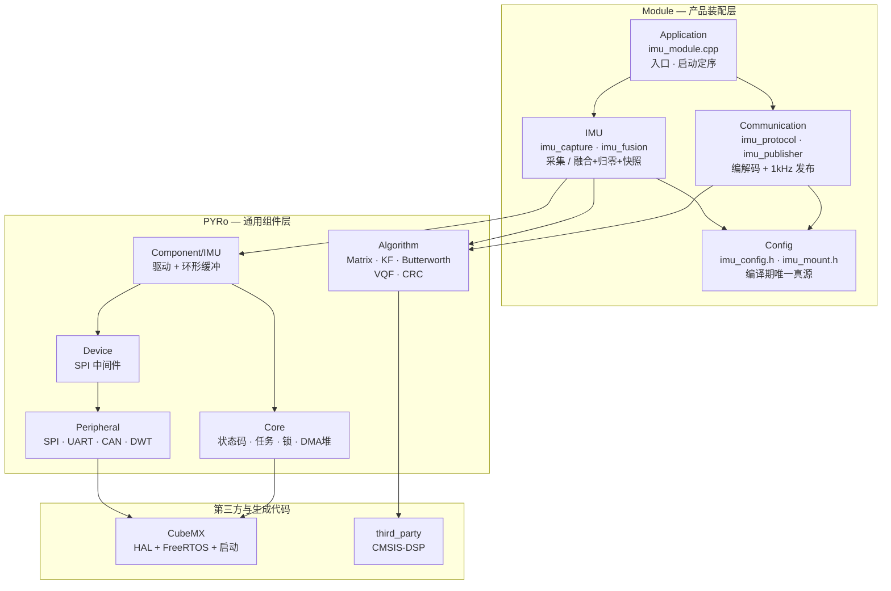
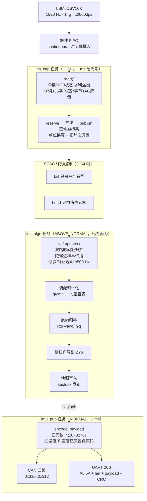
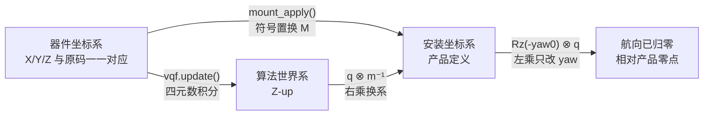
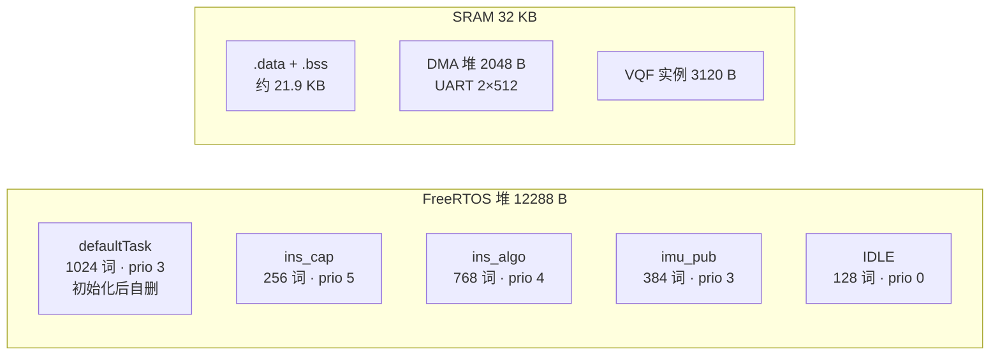
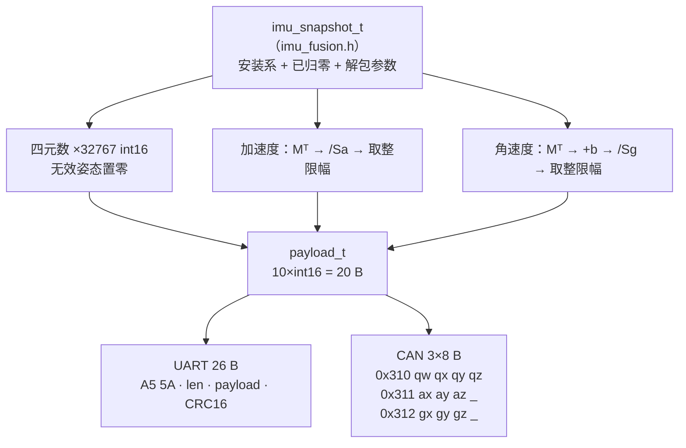

# IMU_Module 结构说明

> 本文档描述 2026-11-17 整理后的代码结构。所有图示为实际代码结构的对应，
> 不是规划。规模数据取自 Release 构建实测。

## 1. 分层与依赖方向

**单向依赖 `Module → PYRo → CubeMX/CMSIS-DSP`**，无反向引用。
`Module` 持有全部产品参数与协议定义，`PYRo` 不感知产品如何装配。

| 层 | 规模 | 职责边界 |
|---|---|---|
| `Module` | 11 个源文件 / 1482 行 | 产品参数、装配顺序、协议 v1、对外快照 |
| `PYRo` | 驱动 / 算法 / 外设 / 核心设施 | 可复用，不含产品语义 |
| `CubeMX` | HAL / FreeRTOS / 启动 | CubeMX 生成，手改处均有 `USER CODE` 标记 |

## 2. 运行时数据流

关键点：

- **`read()` 与 `update()` 分属不同任务**，中间只靠 SPSC 环形缓冲交接，
  全程**不使用任何临界区**（索引所有权分离 + publish 屏障）。
- `ins_cap` 的周期是硬约束：`read()` 内部两段 DMA 等待会挂起任务，
  融合耗时再高也不挤占这个周期。
- 快照是**值拷贝 + seqlock**，`imu_pub` 与融合任务零共享。

## 3. 坐标系变换链

**为什么换系放在输出端而非驱动端**：8 种安装方向全是符号置换矩阵
（行列式 +1），而 VQF 内部的逐通道低通、逐轴限幅、模长判据对该置换不变，
因此两种放法数学等价。该等价性**只在符号置换下成立**，若将来支持任意
安装角必须重新设计（见 `imu_mount.h` 头部注释）。

反向（安装系 → 器件系，用于封包）**必须用导出的逆表**，
不能直接复用正向表——`DIRECT_2`/`DIRECT_4` 这类"换轴+非对称取反"会算错。

## 4. 任务与资源

| 任务 | 栈 | 优先级 | 周期 | 实测高水位余量 |
|---|---|---|---|---|
| `ins_cap` | 256 词 | 5 (HIGH) | 1 ms 硬 | 165 词 |
| `ins_algo` | 768 词 | 4 (ABOVE_NORMAL) | 尽力而为 | 169 词 |
| `imu_pub` | 384 词 | 3 (NORMAL) | 1 ms | 269 词 |

## 5. 协议编解码（纯函数层）

**协议层零硬件依赖**，可在主机上逐字节验证。UART 帧 CRC 直接复用
`PYRo/Algorithm/CRC` 的 `append_crc16_check_sum()`（反射查表族，
poly 0x1021 反射、init 0xFFFF、无 xorout，校验向量 `123456789` → `0x6F91`）。
产品尚未定型，最终对端参数以正式发布的协议文档为准；帧结构与覆盖范围不变。

## 6. 目录职责速查

| 路径 | 职责 | 关键约束 |
|---|---|---|
| `Module/Application/` | 启动定序：INS → 发布 | 顺序不可交换 |
| `Module/Config/imu_config.h` | 器件/融合/发布/任务参数 | 编译期唯一真源 |
| `Module/Config/imu_mount.h` | 8 方向映射 + 逆表导出 | 正向表不可复用于反向 |
| `Module/IMU/imu_capture.*` | 器件对象、read()、SPSC 生产、采集统计 | 唯一持有硬件的地方 |
| `Module/IMU/imu_fusion.*` | VQF/ESKF、归一化、归零、快照 | 只消费缓冲，不碰总线 |

| `Module/Communication/imu_protocol.*` | 协议 v1 编解码 | 纯函数，主机可测 |
| `Module/Communication/imu_publisher.*` | 1 kHz CAN/UART 发布 | 忙则丢整组，不重试 |
| `PYRo/Component/IMU/` | 驱动 + SPSC 环形缓冲 | 输出器件坐标系 |
| `PYRo/Algorithm/VQF/` | VQF + 6 维误差状态 ESKF | 器件系工作，yaw 不可观测 |
| `PYRo/Algorithm/CRC/` | CRC16（反射查表族）+ CRC8 | UART 帧复用其 `append_crc16_check_sum` |
| `PYRo/Peripheral/` | SPI/UART/CAN/DWT 封装 | ISR 路由用定容 map |

## 7. 已验证的判据

| 验证 | 方法 | 结果 |
|---|---|---|
| 协议字节向量 | 主机 g++ 编译 imu_protocol.cpp + PYRo CRC | 32 checks / 0 fail；3775 万组原码回环误差恒 0（测试文件已随 Module/tests 移除，判据留档）|
| VQF/ESKF 数值 | `python PYRo/tests/run_vqf_eskf.py` | 8 个用例全通过，`sizeof(vqf_t)=3120 B` |
| SPSC 并发 | `python PYRo/tests/run_spsc_test.py` | 400 万样本无撕裂/乱序/丢失；变异测试确认判据有效 |
| 采集解耦 | 上板实测 | `cap_rounds` 与 `algo_rounds` 独立，采集稳 1000.4 Hz |
| UART CRC | 上板抓帧 + 独立复算 | `0xB0BE` 与线上帧尾一致 |

## 8. 关键设计取舍（有实测支撑）

| 决策 | 依据 |
|---|---|
| **单生产者/单消费者 + 无锁** | 400 万样本并发测试；旧实现的 `count` 双方读改写是竞争源 |
| **满则丢弃新样本**（不覆盖最旧） | 覆盖需移动 `head`，而 `head` 属消费者；A1 使 `err_data` 成为纯背压计数 |
| **采集与融合拆双任务** | 1920 Hz 下 `vqf_us` 峰值 835 µs 曾串在 1 ms 周期里；拆分后采集不受影响 |
| **`rest_filter_tau = 0.15 s`** | 实测：τ=0.5 时静止判决建立瞬间 `rest_lp_z` 符号都错（−0.0011 vs 真值 +0.0022），yaw 突变 0.45~1.6°；τ=0.15 后误差降到 0.000065 rad/s，突变消失 |
| **`motion_bias_est_enabled = false`** | 开启时多一条 `bias_z` 修改通道，逻辑更复杂；实测其贡献极小（8 s 仅 0.000047 rad/s） |
| **ODR 保持 1920 Hz** | 7680 Hz 实测 `vqf_us` 达 8.3 ms、`err_data` 每秒涨 1000，链路饱和 |
| **CRC 复用 PYRo 既有实现** | 产品未定型，对端参数由正式发布协议指定；直接复用 `append_crc16_check_sum`，不在协议层新增算法实现。实测 6/6 帧 CRC 一致 |

## 9. 后续待办

1. **7680 Hz**：需先压低单批成本（矩阵块化、Butterworth 递推改 float），
   再重测峰值；当前架构已支持"融合慢不影响采集"。
2. **CAN 物理层**：台架无第二节点，未验证 ACK 与总线负载下的丢组率。
3. **发布优先级**：`imu_pub`(3) 低于 `ins_algo`(4)，融合满载时发布约 845 Hz，
   需按产品需求决定是否提升。
4. **`.ioc` 脱钩**：`CubeMX/IMU_Module.ioc` 里 `TOTAL_HEAP_SIZE`/`Tasks01`
   仍是旧值，重新 Generate 会覆盖手改配置。
